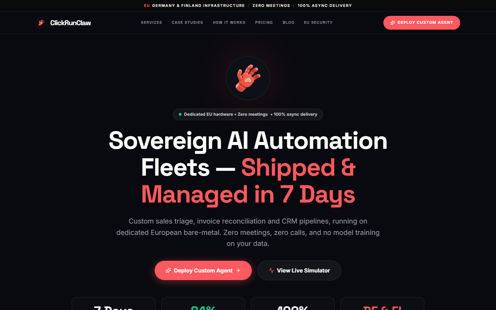
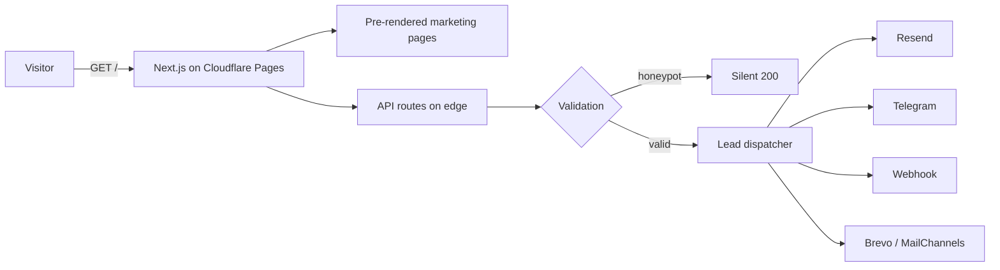

# ClickRunClaw

**EU-first AI automation studio.** Custom agents for sales triage, customer support and invoice reconciliation, built and hosted on dedicated German and Finnish infrastructure.

This repository is the production marketing site and lead-intake system behind [clickrunclaw.com](https://clickrunclaw.com).

[](https://nextjs.org)
[](https://react.dev)
[](https://tailwindcss.com)
[](https://pages.cloudflare.com)
[](#testing)
[](LICENSE)



---

## What is in here

| Area | Detail |
| --- | --- |
| **Marketing site** | Home, services, pricing, case studies, seven-day process, EU security, privacy |
| **Editorial** | Blog index and four long-form engineering articles, statically generated |
| **Conversion** | Interactive workflow simulator, live agent demo, ROI calculator, project brief form |
| **Lead intake** | Edge API route with validation, honeypot, rate limiting and multi-channel dispatch |
| **SEO** | Pre-rendered HTML, per-page metadata and canonicals, JSON-LD, sitemap, RSS, Open Graph |
| **Quality** | 71 unit and integration tests, strict TypeScript, CI workflow |

### Measured build facts

- Every marketing route is pre-rendered at build time; only the four API routes run on demand.
- Blog articles use `generateStaticParams` and are emitted as static HTML.
- First load JavaScript for the homepage: **140 kB** (down from 188 kB).
- 71 tests pass on `npm test`.

---

## Stack

| Layer | Choice |
| --- | --- |
| Framework | Next.js 15 App Router, React 19 |
| Styling | Tailwind CSS 4 with a small design-token layer in `app/globals.css` |
| Type | Inter, Space Grotesk, JetBrains Mono via `next/font` |
| Icons | Lucide |
| Motion | CSS keyframes for entry, Framer Motion only where state transitions need it |
| Hosting | Cloudflare Pages (V8 isolates) via `@cloudflare/next-on-pages` |
| Email | Resend, Brevo, MailChannels (HTTP APIs, no SMTP) |
| Alerts | Telegram Bot API, generic webhook (Discord, Slack, n8n, Make) |

---

## Architecture



### Routes

| Route | Rendering | Purpose |
| --- | --- | --- |
| `/` | Static | Landing page, simulator, demo, ROI calculator, brief form |
| `/services` | Static | Three agent architectures and the integration surface |
| `/pricing` | Static | Package comparison and ROI model |
| `/case-studies` | Static | Three delivered builds with metrics |
| `/how-it-works` | Static | The four-checkpoint async protocol |
| `/blog` | Static | Article index |
| `/blog/[slug]` | SSG | Article pages with table of contents and article schema |
| `/security` | Static | Infrastructure and data residency |
| `/privacy` | Static | GDPR policy |
| `/sitemap.xml`, `/robots.txt`, `/feed.xml` | Static | Crawler surface |
| `/api/lead` | Edge | Lead intake (primary) |
| `/api/contact`, `/api/project-brief` | Edge | Backwards-compatible aliases |
| `/api/demo` | Edge | Live agent demo, rate limited |

---

## Lead pipeline

`POST /api/lead` accepts a JSON brief and runs five steps:

1. **Payload guard** — JSON parse, 20 kB body cap.
2. **Honeypot** — the hidden `websiteHoneypot` field gets a normal `200` and no dispatch.
3. **Rate limit** — sliding window per IP, five submissions per ten minutes.
4. **Validation** — name, email, package tier and workflow text are normalised and sanitised in `lib/lead.ts`.
5. **Dispatch** — every configured channel is attempted in parallel. If no channel accepts the brief the API returns `502` and tells the visitor to email `support@clickrunclaw.com` directly, rather than reporting a false success.

CORS is restricted to the production origin, and `GET /api/lead` is a status probe only: it no longer reports which providers are configured.

### Environment variables

Copy `.env.example` to `.env.local` for development, or add the values in **Cloudflare Pages → Settings → Environment variables**.

| Variable | Required | Purpose |
| --- | --- | --- |
| `RESEND_API_KEY` | Recommended | Owner alert and client acknowledgement email |
| `LEAD_TO_EMAIL` | Recommended | Inbox that receives briefs |
| `LEAD_FROM_EMAIL` | Optional | Verified sender, falls back to Resend sandbox |
| `TELEGRAM_BOT_TOKEN` / `TELEGRAM_CHAT_ID` | Optional | Instant mobile push |
| `LEAD_WEBHOOK_URL` | Optional | Discord, Slack, n8n or Make |
| `BREVO_API_KEY` | Optional | Alternative email provider |
| `GEMINI_API_KEY` | Optional | Live agent demo; deterministic fallback without it |
| `NEXT_PUBLIC_SITE_URL` | Optional | Canonical origin used for CORS and metadata |

---

## Local development

```bash
npm install
npm run dev          # http://localhost:3000
npm test             # 71 tests
npx tsc --noEmit     # strict type check
npm run build        # production build
```

## Deployment

Cloudflare Pages, Node 20 build image:

```bash
npx @cloudflare/next-on-pages@1
```

| Setting | Value |
| --- | --- |
| Build command | `npx @cloudflare/next-on-pages@1` |
| Output directory | `.vercel/output/static` |
| Compatibility flags | `nodejs_compat` |
| Node version | 20 or newer |

`public/_headers` sets HSTS, a content security policy, framing protection and immutable caching for `/_next/static/*`.

---

## Project structure

```
app/
  api/                 Edge route handlers (lead, demo, aliases)
  blog/                Index, article pages, SSG params
  case-studies/        Delivered work
  components/          Header, footer, analytics consent, page shells
  how-it-works/        Delivery protocol
  pricing/             Packages and comparison
  privacy/  security/  Legal and infrastructure
  services/            Agent architectures
  globals.css          Design tokens and base layer
  layout.tsx           Fonts, metadata, JSON-LD
  page.tsx             Home metadata + structured data
  sitemap.ts robots.ts feed.xml/
components/            Simulator, live demo, ROI calculator, brief form
lib/                   Content, lead validation, demo agent, site constants
tests/                 Node test runner suites
docs/                  Architecture notes, audit, screenshots
public/                Brand assets, Open Graph image, headers
```

---

## Design system

| Token | Value | Use |
| --- | --- | --- |
| Ink | `#090A0F` | Page shell |
| Panel | `#111318` | Cards and surfaces |
| Hairline | `rgba(255,255,255,0.09)` | Borders and dividers |
| Coral | `#FF5A5F` | Primary action and emphasis |
| Text | `#FAFAFA` / `#A1A1AA` | Primary and secondary copy |

Type: Space Grotesk for display, Inter for body, JetBrains Mono for labels and data. Focus states use a 2 px coral outline; motion collapses under `prefers-reduced-motion`.

---

## The studio

**ClickRunClaw** is the AI automation studio of [CryptoWebBuild](https://cryptowebbuild.com), founded by Sagor Ahamed.

- Written briefs only: no discovery calls, no video meetings.
- Dedicated infrastructure in Frankfurt, Germany and Helsinki, Finland.
- Full code, prompt and infrastructure ownership on handover.
- Contact: [support@clickrunclaw.com](mailto:support@clickrunclaw.com)

## Licence

Code is released under the MIT licence. The ClickRunClaw name, logo, case-study data and editorial content remain the property of ClickRunClaw. See [LICENSE](LICENSE).
